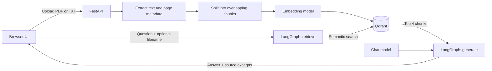

# enterprize-rag

### Your documents, in conversation.

A simple enterprise RAG starter that turns PDFs and text files into a searchable knowledge base. Upload a document, ask a question, and get an answer with references to the excerpts used to generate it.

Built with **FastAPI**, **LangGraph**, **LangChain**, **Qdrant**, and a lightweight browser UI. Run chat and embeddings locally with **Ollama**, or configure supported cloud providers.

[Quick start](#quick-start) · [How it works](#how-it-works) · [Configuration](#configuration) · [API](#api) · [Current-scope](#current-scope)

## What you can do

- **Build a knowledge base:** upload text-based PDFs and UTF-8 `.txt` files through the UI or API.
- **Ask across documents:** search the whole collection or limit a question to one filename.
- **Inspect the evidence:** answers are prompted to cite numbered excerpts; API responses include source text, filenames, and PDF page numbers.
- **Manage documents:** list indexed files and delete all chunks associated with a filename.
- **Choose your models:** configure chat and embeddings independently.
- **Explore the interface:** try the built-in demo workspace before connecting a backend.
- **Keep indexed data between runs:** Compose uses named volumes for Qdrant storage and downloaded Ollama models.

## How it works



**Ingestion:** extract text, keep filename and PDF page metadata, split into 1,000-character chunks with 150-character overlap, then embed and store the chunks in Qdrant.

**Retrieval:** embed the question and retrieve up to four similar chunks. A filename filter restricts retrieval to the selected document.

**Generation:** send the question and retrieved excerpts to the chat model. The prompt requests excerpt citations such as `[1]`, asks the model to acknowledge missing information, and treats document content as reference material rather than instructions.

The LangGraph workflow is compiled once at startup: `START → retrieve → generate → END`.

## Quick start

### 1. Prerequisites

- Docker with Docker Compose available as `docker compose`.
- Enough disk space and memory for your chosen Ollama models.
- A text-based PDF or UTF-8 text file to upload.

Run the following commands from the repository root.

### 2. Configure the environment

Create or update `.env` with this local Ollama configuration. These are example model choices; you can substitute models available in your environment.

```dotenv
OLLAMA_URL=http://ollama:11434
QDRANT_URL=http://qdrant:6333
COLLECTION=office_documents

CHAT_PROVIDER=ollama
CHAT_MODEL=llama3.2

EMBEDDING_PROVIDER=ollama
EMBEDDING_MODEL=nomic-embed-text
```

The hostnames `ollama` and `qdrant` resolve inside the Compose network. Compose passes `.env` to the API container. The repository ignores `.env`; keep provider credentials out of version control.

### 3. Start storage and download the models

```sh
docker compose up -d qdrant ollama
docker compose exec ollama ollama pull llama3.2
docker compose exec ollama ollama pull nomic-embed-text
```

The model names must match `CHAT_MODEL` and `EMBEDDING_MODEL`. If Ollama is still starting, retry the pull command once it is ready.

### 4. Build and start the application

```sh
docker compose up -d --build
```

| Service | Address |
| --- | --- |
| Browser workspace | [http://localhost:8080](http://localhost:8080) |
| Interactive API docs | [http://localhost:8000/docs](http://localhost:8000/docs) |
| API health endpoint | [http://localhost:8000/health](http://localhost:8000/health) |

### 5. Connect, upload, and ask

1. Open the browser workspace. On first visit, it starts in **demo mode**, which uses sample data and sample answers.
2. Open the connection settings, enter **`/api`**, and connect. Nginx forwards this path to FastAPI on the internal network.
3. Upload a `.pdf` or `.txt` file and wait for indexing to finish.
4. Ask a question, or select one document to narrow the search.
5. Inspect the source labels; hover over a label to see its retrieved excerpt.

Try questions such as “What are the key points in this document?” or “What does the policy say about onboarding?”

The UI remembers the API connection in browser local storage. The UI and Nginx limit uploads to 20 MB; the API itself does not enforce an equivalent upload-size limit.

### Everyday commands

```sh
# Inspect running services
docker compose ps

# Follow API logs
docker compose logs -f api

# Stop services; keep the named data volumes
docker compose down
```

## Configuration

| Variable | Purpose |
| --- | --- |
| `QDRANT_URL` | Qdrant endpoint; `http://qdrant:6333` inside Compose. |
| `COLLECTION` | Qdrant collection used for document chunks. |
| `OLLAMA_URL` | Ollama endpoint; required when using Ollama for chat or embeddings. |
| `CHAT_PROVIDER` | Provider passed to LangChain's `init_chat_model`, for example `ollama`, `openai`, or `google_genai`. |
| `CHAT_MODEL` | Chat model identifier for the chosen provider. |
| `EMBEDDING_PROVIDER` | `ollama`, `openai`, or `google_genai`; defaults to `ollama` when omitted. |
| `EMBEDDING_MODEL` | Embedding model identifier for the chosen provider. |
| `OPENAI_API_KEY` | Credential when using the OpenAI integration. |
| `GOOGLE_API_KEY` | Credential when using the Google GenAI integration. |

Chat and embedding models can use different providers. The dependencies include the Ollama, OpenAI, and Google GenAI integrations; cloud configuration requires appropriate credentials and model access.

After editing `.env`, apply the configuration with `docker compose up -d api`. If you change the embedding model, use a new collection and re-upload the documents so stored vectors and query embeddings remain compatible.

With Ollama configured for both chat and embeddings, model inference runs in the local Ollama container. With cloud providers, question and document content needed for the configured embedding or generation step is sent to that provider.

## API

| Method | Endpoint | Purpose |
| --- | --- | --- |
| `GET` | `/health` | Return `{"status":"ok"}`; does not check model or database readiness. |
| `POST` | `/documents` | Upload one file using the multipart field `file`. |
| `GET` | `/documents` | List filenames, chunk counts, and indexed PDF page numbers. |
| `DELETE` | `/documents?filename=...` | Delete all chunks matching the exact filename. |
| `POST` | `/chat` | Ask a question with an optional filename filter. |

Use [Swagger UI](http://localhost:8000/docs) to try the endpoints interactively. The following examples use `curl`; on Windows PowerShell, use `curl.exe` to avoid the legacy alias.

### Upload a document

```sh
curl -X POST http://localhost:8000/documents -F "file=@handbook.pdf"
```

The response contains `filename` and `chunks`, the number of chunks indexed.

### Ask a question

Send this JSON to `POST /chat` through Swagger UI or your HTTP client:

```json
{
  "question": "What are the main onboarding steps?",
  "filename": "handbook.pdf"
}
```

Omit `filename` or set it to `null` to search across the collection. Questions must contain between 1 and 4,000 characters.

Illustrative response; the answer and excerpts depend on your document and model:

```json
{
  "answer": "New employees should complete the onboarding checklist [1].",
  "sources": [
    {
      "id": 1,
      "filename": "handbook.pdf",
      "page": 2,
      "text": "Complete the onboarding checklist during your first week."
    }
  ],
  "selected_document": "handbook.pdf"
}
```

Source IDs correspond to the numbered excerpts supplied to the model. Text-file sources have `page: null`. The `sources` array contains retrieved excerpts, and the model may use only some of them in its answer.

### List or delete documents

```sh
curl http://localhost:8000/documents
curl -X DELETE "http://localhost:8000/documents?filename=handbook.pdf"
```

URL-encode filenames containing spaces or special characters.

## Project structure

```text
.
├── main.py                  # FastAPI endpoints, ingestion, and LangGraph workflow
├── requirements.txt         # Python dependencies
├── Containerfile            # Python 3.12 API image
├── compose.yaml             # API, Qdrant, Ollama, and frontend services
├── .env                     # Local configuration and credentials; ignored by Git
├── .gitignore
├── readme.MD
└── frontend/
    ├── index.html           # Browser workspace, demo mode, and API client
    ├── nginx.conf           # Static hosting and /api reverse proxy
    └── Containerfile        # Nginx frontend image
```

## Troubleshooting

| Symptom | What to check |
| --- | --- |
| The UI shows sample answers | Connect to `/api` to leave demo mode. |
| Chat reports “Upload a document first.” | Upload a readable file to the configured collection. |
| Ollama reports a missing model | Pull the exact configured model inside the Compose Ollama service. |
| Upload reports no readable text | Scanned PDFs need OCR before upload; OCR is not included. |
| Embedding or vector compatibility errors | Check the embedding model and collection. Use a new collection and re-upload after changing embedding models. |
| The API fails during startup | Check `docker compose logs api`, required environment variables, and dependency availability. Compose starts dependencies without readiness checks. |
| A custom API URL fails in the browser | Use `/api` for the bundled setup. Separate origins need CORS configuration; an HTTPS frontend also needs an HTTPS API. |

## Current scope

This is a compact starter for experimenting with enterprise document Q&A. Its current implementation has these boundaries:

- **Shared workspace:** no authentication, per-user document access, tenant isolation, or audit trail. The bundled Compose configuration binds the UI and API to localhost.
- **Filename-based identity:** uploading the same filename again appends chunks. Listing groups them together, and deleting that filename removes all matching chunks.
- **Text extraction only:** supports PDF and UTF-8 TXT; no OCR, Office document parsing, or table-specific extraction.
- **Single-turn questions:** previous messages appear in the UI but are not sent to the backend as conversation history.
- **Basic semantic retrieval:** fixed chunk settings and top-four retrieval; no reranking, hybrid search, or relevance threshold.
- **Model-generated citations:** the prompt requests citations and grounded answers; the application does not independently verify them.
- **Synchronous processing:** uploads and generation run within requests, without background jobs or streamed answers.
- **Development-oriented dependencies:** Python packages and the Qdrant/Ollama container images are not pinned to fixed versions.

Before a shared enterprise deployment, add access controls, upload limits at the API boundary, operational monitoring, and retrieval evaluation for your documents and use case.
